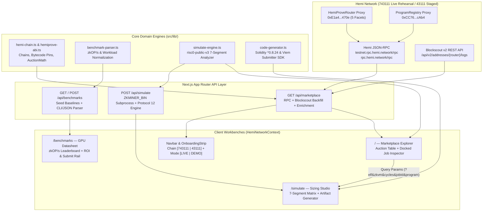

# ARCHITECTURE.md — HemiProve Hub Engineering Specification

This document details the system architecture, on-chain indexing pipeline, ABI contract surface, and mathematical models implemented in **HemiProve Hub**. It is written as a direct technical reference for **Hemi Labs engineers** (`zk-miner` / `zkmarket`) and **open-source contributors**.

---

## 1. System Topology & Data Flow

HemiProve Hub is a Next.js 15 App Router application (`TypeScript 5.8`, `React 19`, `viem 2.x`, `TanStack Query v5`) structured around three master-detail telemetry workbenches sharing a single global chain and data-mode context.



---

## 2. Repository Directory Structure

```text
hemiprove-hub/
├── .env.example                      # Optional ZKMINER_BIN & Mainnet 43111 promotion vars
├── .eslintrc.json                    # Next.js Core Web Vitals & TypeScript ESLint config
├── .github/
│   └── workflows/ci.yml              # GitHub Actions CI (typecheck, lint, test, build)
├── ARCHITECTURE.md                   # Protocol, indexing, and simulation math specification
├── DESIGN.md                         # Warm Matte Carbon datasheet UI/UX constraints
├── LICENSE                           # MIT open-source license
├── README.md                         # Overview, contract matrix, and quickstart guide
├── next.config.mjs                   # Next.js 15 build & outputFileTracingRoot config
├── package.json                      # Dependencies and scripts (`dev`, `build`, `lint`, `test`)
├── pnpm-lock.yaml                    # Locked dependency graph
├── tailwind.config.ts                # Datasheet color tokens, JetBrains Mono & Inter fonts
├── scripts/
│   └── register-paths.mjs            # Node loader hooks resolving `@/*` & TS extensions for `pnpm test`
└── src/
    ├── app/
    │   ├── api/
    │   │   ├── benchmarks/route.ts   # Seed + runtime community benchmark store & validator
    │   │   ├── hemi-price/route.ts   # 60s-cached CoinGecko HEMI/USD spot price & 24h delta proxy
    │   │   ├── marketplace/route.ts  # Live viem RPC + Blockscout v2 indexer & ProgramRegistry reader
    │   │   └── simulate/route.ts     # Hybrid local `zkminer simulate` binary + deterministic engine
    │   ├── benchmarks/page.tsx       # [02] Multi-vendor GPU zkOP/s datasheet, ROI & CLI submit rail
    │   ├── simulate/page.tsx         # [03] Pre-claim sizing console, po2 matrix & contract generator
    │   ├── globals.css               # Matte carbon CSS variables & scrollbar/tabular styling
    │   ├── layout.tsx                # Root shell: Providers -> Navbar -> OnboardingStrip -> main
    │   └── page.tsx                  # [01] Live auction explorer & docked job telemetry inspector
    ├── components/
    │   ├── navbar.tsx                # Protocol telemetry bar + chain/mode hardware switches
    │   ├── onboarding-strip.tsx      # Dismissible 1-line 3-step workflow bar (localStorage-persisted)
    │   ├── providers.tsx             # React Query + HemiNetworkContext global provider
    │   └── ui/                       # Datasheet primitives (info-tip portal, button, input, switch)
    ├── data/
    │   └── seed-benchmarks.json      # 13 calibrated NVIDIA CUDA, AMD ROCm/HIP & Intel SYCL baselines
    └── lib/
        ├── __tests__/
        │   ├── api-routes.test.ts    # Offline-mocked integration tests for all 4 API routes
        │   ├── hemiprove.test.ts     # Unit tests (AuctionMath, parser, simulation, codegen, ABI/events)
        │   └── mock-logs.ts          # ABI-encoded Blockscout router event test fixtures
        ├── benchmark-parser.ts       # Dual `zkminer benchmark` CLI stdout & `--json` parser
        ├── code-generator.ts         # Solidity (`IHemiProveCallback`) & TypeScript (`viem`) codegen
        ├── hemi-chain.ts             # Chain definitions, deployments, code pins, proofSystemIds, AuctionMath
        ├── hemiprove-abi.ts          # Exact HemiProveRouter, Staking, ProgramRegistry & ERC20 ABIs
        ├── marketplace-data.ts       # Job types, ELF URI source classifier, LIVE vs DEMO KPI builders
        ├── marketplace-events.ts     # Router event correlation (JobSubmitted/Claimed/Fulfilled) & settlement timing
        ├── simulate-engine.ts        # Protocol 12 (`risc0-public-v3`), SP1 & OpenVM sizing math
        └── utils.ts                  # Class merge (`cn`), hex truncation, and duration formatters
```

---

## 3. Ground-Truth Chain & Contract Integration

### 3.1 Diamond-Lite Router Architecture & Audited Bytecode Pins
In `zkmarket@c8333aa` (mirrored from `crates/zkminer-chain/src/deployment.rs`), `HemiProve` is deployed behind an ERC-1967 proxy (`0xE1a492Dc6D57fCC2B6deb5B64087E69666cA470e` on Hemi Sepolia `743111`) that `delegatecall`s into 5 facets: `Core`, `Fulfill`, `FulfillCycle`, `Aux`, and `AuxGov`.

`src/lib/hemi-chain.ts` records the exact runtime bytecode hashes (`AUDITED_CODE_PINS`) pinned by `zkminer`:
- `erc1967Proxy`: `0x46a010df31eb642b47284650e80051e8f6239a0c995003d230b437810bc4b9b4`
- `routerImpl`: `0xfe19d149183c16c2c5917745002d824fb94dc5f1766d8ecf2f1e2ab4c5f6d2aa`
- `stakingImpl`: `0x8f2769b1ac7e443981de10adba5962fd42552bd14f10006b5f30921eb70aea94`
- `registryImpl`: `0xf6ea9179aa36f691770372da03089f89bd0f6b0e52a7976ad749167f9b4388b2`
- `programRegistryImpl`: `0x2b4b0456f6994a01cf2adf63ad65a2b1073cbfe3d1000cc8417beb0a9c7d5203`
- `risc0Selector`: `0x73c457ba`
- `sp1V6_1_0Groth16VerifierHash`: `0x4388a21c687fdd5f218d7e3d13190cac4c5355818d3605fd5fb811df468ee696`

### 3.2 Chain State Isolation (`743111` Active vs `43111` Staged)
`HemiNetworkContext` (`src/components/providers.tsx`) defaults to `networkKey = "sepolia"` (`743111`) and `liveStreamEnabled = true` (`DATA: DEMO` showcase stream, persisted in `localStorage` once toggled):
- **Sepolia (`743111`):** `deployment.deployed = true`, `router = 0xE1a4...470e`, all three verifier indicators (`RISC0`, `SP1`, `OPENVM`) report `ACTIVE`.
- **Mainnet (`43111`):** While `NEXT_PUBLIC_MAINNET_HEMIPROVE_ROUTER` is unset, `deployment.router = null`. The UI renders `ROUTER: STAGED (PRE-DEPLOYMENT)`, suppresses broken Mainnet router links so Sepolia addresses never leak onto `explorer.hemi.xyz`, sets verifiers to `RISC0: STAGED`, `SP1: STAGED`, `OPENVM: 743111-ONLY` (per `INTERACTION_GUIDE.md` §3), and emits `address(0)` + explicit staged-deployment guards into generated Solidity/Viem code so Sepolia router addresses never mix with Mainnet HEMI.

### 3.3 Multi-Stage On-Chain Discovery Pipeline (`GET /api/marketplace`)
When querying an active deployment, `src/app/api/marketplace/route.ts` caches responses per `${network}:${mode}` for `15s` (`?refresh=1` bypasses) and executes a 3-stage pipeline with strict `4,500 ms` timeouts so UI responsiveness never degrades:

1. **Router State + Fast RPC Window Scan:**
   - Reads `jobIndex()`, `paused()`, and `totalPaidToProvers()` in parallel via `Promise.allSettled`.
   - Scans `JobSubmitted`, `JobClaimed`, and `JobFulfilled` logs across `[max(headBlock - 2000, scanFromBlock), headBlock]` (`scanFromBlock = 7,095,745` on Sepolia), retaining up to `36` recent candidates so cancelled bursts never crowd out active jobs.
2. **Historical Blockscout v2 Log Backfill & Timestamp Correlation:**
   - Whenever fewer than `12` candidate jobs exist in the `2,000`-block RPC window, fetches `${blockscoutApiUrl}/addresses/${router}/logs` and decodes `JobSubmitted`, `JobClaimed`, and `JobFulfilled` events via `viem`'s `decodeEventLog` (`src/lib/marketplace-events.ts`), preserving `block_timestamp`, `actualCycles`, and `fulfillTxHash`. Missing timestamps for RPC-only matched jobs are backfilled via deduplicated `getBlock` calls (`<= 12` blocks) to compute exact `settlementSecs` and live `avgSettlementSecs`.
3. **On-Chain Enrichment (`ProgramRegistry` + `getJobStatusView`):**
   - Deduplicates non-zero `programId` values and queries `ProgramRegistry` (`0xCC761A929747A81e34517e1f4F98247da925cAb4`) via `getProgram(programId)` (program name, `familyId`, `resources.estimatedCycles`) and `getStorageURIs(programId)` (`StorageType`: `0 = IPFS`, `1 = Arweave`, `2 = HTTP`, `3 = Custom`).
   - Queries `HemiProveRouter.getJobStatusView(jobId)` and `eth_getCode(caller)` in batches of `12` until up to `12` valid jobs are collected:
     - Maps `JobStatus`: `1 -> Open`, `2 -> Claimed`, `3 -> Verified (Fulfilled)`, and filters out `0 (None)` and `4 (Cancelled)` so cancelled rehearsal jobs are never misclassified as open auctions.
     - Classifies `caller` bytecode (`code !== "0x"`) into `Smart Contract` vs `EOA`.
4. **Strict `LIVE` vs `DEMO` Separation:**
   - In `DATA: LIVE` (`!liveStreamEnabled`), `src/app/page.tsx` consumes `data.onChainJobs` and `data.liveKpis` exclusively. If `0` active jobs match, both the table and the right-hand Inspector render synchronized empty states with one-click switches to `DEMO` stream or `SEPOLIA 743111` — never falling back to mocked KPI numbers or synthetic job rows. In `DATA: DEMO`, `buildBaselineKpis` derives KPI counts directly from the displayed jobs slice.

---

## 4. Mathematical Models & Sizing Formulas

### 4.1 Reverse Dutch Auction Escalation (`computeEscalatingOffer`)
Mirrored from `crates/zkminer-chain/src/auction.rs` (`AuctionMath.computePrice`) in `src/lib/hemi-chain.ts`:

Given minimum offer $P_{\min}$, maximum offer $P_{\max}$, ramp-up period $T_{\text{ramp}} > 0$, and elapsed auction seconds $t$:
- If $t \le 0$ or $P_{\min} \ge P_{\max}$: $P(t) = P_{\min}$ (or $P_{\max}$ if $P_{\min} \ge P_{\max}$).
- If $t \ge T_{\text{ramp}}$: $P(t) = P_{\max}$.
- Otherwise, let $r = \frac{t}{T_{\text{ramp}}} \in (0, 1)$:

$$
P(t) = \begin{cases}
P_{\min} + (P_{\max} - P_{\min}) \cdot r & \text{if } \texttt{curveType} = 0 \text{ (Linear)} \\[6pt]
P_{\min} + (P_{\max} - P_{\min}) \cdot r^2 & \text{if } \texttt{curveType} = 1 \text{ (Quadratic)}
\end{cases}
$$

---

### 4.2 Protocol 12 `zkOP/s` Self-Scoring, 5-Program Suite & Windows Driver Telemetry (`src/lib/benchmark-parser.ts`)
Mirrored from `crates/zkminer-prover-protocol/src/suite.rs`, `types.rs`, and `crates/zkminer-prover/src/benchmark.rs` (`max/windows-gpu` commit `101edae` & `a12ce82`):

1. **Miner-Driven Self-Scored `zkOP/s` (`measure_zkop_mix`):**
   - **1 `zkOP` is defined as 1 Succinct SP1 RISC-V cycle** on the `zkop-mix` guest at `ZKOP_MIX_ITERATIONS = 3,202`, which equals **`ZKOP_MIX_SP1_CYCLES = 50,007,139`** SP1 cycles.
   - Under Protocol 12, the host miner drives `measure_zkop_mix` directly: 1 discarded warm-up proof (`200` iterations) followed by up to `3` scored proofs inside a `60.0s` budget, taking the **median** STARK proving duration $T_{\text{stark,median}}$:

$$
\text{zkOP/s} = \operatorname{round}\!\left(\frac{50{,}007{,}139}{T_{\text{stark,median}}}\right)
$$

2. **Canonical 5-Program Benchmark Suite (`BENCHMARK_PROGRAMS`):**
   - `WorkerCommand::Benchmark { programs: benchmark_suite(backend) }` dispatches the 5 canonical programs (weights summing to `1.0`; `fibonacci` was dropped in `f54b3b9` so its fixed per-proof overhead on RISC Zero and 15.6M c/s skew on SP1 never distort cycle-weighted job time predictions):
     - **45% Precompile:** `sha256-chain` (`20%` weight; input `10,000` RISC0 / `50,000` SP1), `ecdsa-verify` (`25%` weight; input `10`).
     - **40% Pure Compute:** `bigint-mul` (`20%` weight; input `100`), `chacha-mix` (`20%` weight; input `5,000` RISC0 / `20,000` SP1).
     - **15% Mixed:** `memory-merkle` (`15%` weight; input `512` RISC0 / `1,024` SP1).
   - **STARK Rate & Groth16 Wrap Split (`program_stages`):**
     - `DeviceBenchmark::stark_rate()` computes the **cycle-weighted STARK rate** across the 5 priced suite programs ($\sum \text{cycles} / \sum \text{stark\_secs}$, excluding `zkop-mix`), while `DeviceBenchmark::wrap_secs()` takes the **median** Groth16 wrap latency (timed across all 5 programs on RISC Zero, or once by difference on the final `chacha-mix` program on SP1 after GPU warm-up is paid).

3. **Windows Native Vendor Driver Telemetry (`crates/zkminer-tui/src/windows_telemetry/` on `main`; moving to `crates/zkminer-prover/src/windows_telemetry/` in `max/splash-progress-bars` `df6c7f8`):**
   - On Windows (where `/sys/class/drm` is absent), `zkminer` loads vendor driver libraries at runtime and joins physical cards by canonical 4-digit domain PCI bus ID (`0000:bus:dev.fn`):
     - **Intel (`IGCL` / `ControlLib.dll`):** Negotiated slot PCIe link (`Gen1`–`Gen6` x width), GPU/VRAM temperatures & clocks, energy/activity counter-delta power & utilization, and throttle limits (`PL1`, `THERMAL`).
     - **AMD (`ADLX` / `amdadlx64.dll`):** Negotiated slot PCIe link, edge/hotspot/memory temperatures, clocks, board power, utilization, fan RPM, voltage, and VRAM used/total.
     - **NVIDIA (`NVML` / `nvml.dll`):** Negotiated slot PCIe link (`current_pcie_link_gen` / `current_pcie_link_width`), clocks, temperatures, fan, VRAM, and power draw.

4. **Dual CLI & JSON Ingestion (`parseZkMinerBenchmark`):**
   - **`zkminer benchmark --json` (`BenchmarkSuite` schema):** Reads top-level `zkops` / `mzkops`, `gpu_power_watts`, `host_peaks`, `results[]` (`program_name`, `prover_backend`, `duration: { secs, nanos }`, `throughput`, `weight`), and `device_benchmarks[]` (`device_label`, `prover_backend`, `optimal_po2`, `memory_usage_bytes`, `pci_bus_id`, `host_peak_bytes`, and `program_stages[]`).
   - **Raw `zkminer benchmark` CLI stdout:** Extracts `zkOP/s: <score>`, upcoming blended `MzkOP/s` (`max/splash-progress-bars`, `ZKOP_SP1_PER_RISC0 = 3.71`), per-card `<device> / <backend>: <score>` lines, `Device Benchmarks` rows, and `Proving stages` sub-tables (using `Groth16 wrap <w>s ... + N / <rate>` footer first, or cycle-weighted `sum(cycles) / sum(stark_secs)` across suite rows when omitted). Assigns deterministic fingerprint IDs and rejects non-positive `tdpWatts`.

Hardware energy efficiency (`SORT: ZKOP/WATT`) is computed as $\frac{\text{zkOP/s}}{\text{TDP}_{\text{watts}}}$.

---

### 4.3 Miner ROI & Electricity Model (`src/app/benchmarks/page.tsx`)
For a rig with $N \in [1, 8]$ GPUs of per-card throughput $Z_{\text{gpu}}$ (`zkOP/s`), TDP $W_{\text{tdp}}$ (watts), MSRP $C_{\text{msrp}}$ (USD), total network throughput $Z_{\text{net}}$ (`zkOP/s`), daily reward pool $R_{\text{pool}}$ (`HEMI`/`tHEMI`), token price $P_{\text{hemi}}$ (USD), and electricity rate $E_{\text{kwh}}$ (`$/kWh`):

$$
\begin{aligned}
Z_{\text{rig}} &= N \cdot Z_{\text{gpu}}, \qquad S_{\text{share}} = \frac{Z_{\text{rig}}}{\max(Z_{\text{rig}},\, Z_{\text{net}})} \\[4pt]
\text{Gross}_{\text{HEMI/day}} &= R_{\text{pool}} \cdot S_{\text{share}}, \qquad \text{Rev}_{\text{USD/day}} = \text{Gross}_{\text{HEMI/day}} \cdot P_{\text{hemi}} \\[4pt]
W_{\text{active}} &= 0.85 \cdot N \cdot W_{\text{tdp}} + 65\,\text{W}_{\text{host}}, \qquad \text{kWh}_{\text{day}} = \frac{24 \cdot W_{\text{active}}}{1000} \\[4pt]
\text{Net}_{\text{USD/day}} &= \text{Rev}_{\text{USD/day}} - \left(\text{kWh}_{\text{day}} \cdot E_{\text{kwh}}\right) \\[4pt]
\text{BreakEven}_{\text{days}} &= \left\lceil \frac{N \cdot C_{\text{msrp}}}{\text{Net}_{\text{USD/day}}} \right\rceil \quad (\text{when } \text{Net}_{\text{USD/day}} > 0)
\end{aligned}
$$

---

### 4.4 `zkminer simulate` Sizing & `risc0-public-v3` (Protocol 12) Math (`src/lib/simulate-engine.ts`)

#### A. RISC Zero Total Charged Cycles & 7-Segment Audit (`po2 = 16..22`)
In RISC Zero (`risczero.groth16.v1`), on-chain `actualCycles` (`report.cycles`) is **not** equal to raw guest instructions alone — it includes power-of-two segment padding plus Keccak coprocessor proof charges (`KECCAK_CHARGE_PER_REQUEST = 2^{20} = 1,048,576` cycles per Keccak request at `keccak po2 = 17`).

For each valid segment exponent $p \in \{16, 17, 18, 19, 20, 21, 22\}$:
- Segment capacity: $S_p = 2^p$ cycles (`65,536` up to `4,194,304`), with ~`92%` usable guest cycle budget before segment split overhead:

$$
\begin{aligned}
K_p &= \max\!\left(1,\, \left\lceil \frac{C_{\text{guest}}(p)}{0.92 \cdot 2^p} \right\rceil\right) \\[4pt]
C_{\text{padded}}(p) &= K_p \cdot 2^p, \qquad C_{\text{pad}}(p) = \max\!\big(0,\, C_{\text{padded}}(p) - C_{\text{guest}}(p)\big) \\[4pt]
C_{\text{keccak}}(p) &= Q_{\text{keccak}}(p) \cdot 1{,}048{,}576 \\[4pt]
C_{\text{total}}(p) &= C_{\text{padded}}(p) + C_{\text{keccak}}(p)
\end{aligned}
$$

*(Concrete verification example — Preset #2 `DeFi LP Volatility Proof` at miner default `po2 = 20`: $C_{\text{guest}} = 41{,}200{,}000$, $K_{20} = \lceil 41.2\text{M} / 964{,}689.92 \rceil = 43$ segments, $C_{\text{padded}} = 43 \times 1{,}048{,}576 = 45{,}088{,}768$, $C_{\text{pad}} = 3{,}888{,}768$, $Q_{\text{keccak}} = 6 \Rightarrow C_{\text{keccak}} = 6{,}291{,}456$, yielding exact `report.cycles` $= 51{,}380{,}224$.)*

**Cross-`po2` Consistency Invariant (`risc0-public-v3`):**
Unless `--single-run` (`--po2 20` only) is enabled, every row $p \in \{16..22\}$ is compared against the reference miner baseline $p_{\text{ref}} = 20$:

$$
\texttt{consistent}(p) \iff \begin{cases}
\texttt{journalHash}(p) = \texttt{journalHash}(20) \\
C_{\text{guest}}(p) = C_{\text{guest}}(20) \\
C_{\text{keccak}}(p) = C_{\text{keccak}}(20) \\
\texttt{randomReads}(p) = \texttt{randomReads}(20)
\end{cases}
$$

If any segment size violates this invariant (as demonstrated in Preset #3 `Segment Inflation Warning Demo`, where a malicious guest branches on `po2 >= 20` and `SYS_RANDOM` entropy to inflate cycles ~15.6x and alter the journal), `sizeCheck` flips to `"differs"`, `binding` flips to `"fails"`, and `zkminer`'s pre-claim guard blocks collateral lockup.

#### B. GPU VRAM Tier Gates
- **RISC Zero (`risc0`):** Peak device memory at `po2 = 20` is `12,436 MiB` (clearing `zkminer`'s `14 GiB` default consumer gate; `12 GiB` cards calibrate down to `po2 = 19` at `8,920 MiB`). Workloads exceeding `140M` charged cycles recommend the **24 GiB+ Flagship Tier** so the `3.45 GB` Groth16 SRS stays resident in VRAM (`>= 20 GiB` rule).
- **Succinct SP1 (`sp1`):** On `main` (`zkmarket@c8333aa`), workloads $\le 134{,}217{,}728$ (`134M`) elements size to **16 GiB** (`15,092 MiB` peak VRAM on CUDA 12.9 / ROCm 10.1), and larger workloads step up to **24 GiB+** (`268M` elements, `17,766 MiB`). *(Pending upstream `PR #33` `b5de292` reduces SP1 v6.1.0 measured tiers to `9,500 MiB` and `12,000 MiB`.)*
- **OpenVM (`openvm`):** Recommends **24 GiB VRAM + 32 GiB host RAM** for Halo2 outer recursion + KZG SRS and validates `extraVerifierData = abi.encode(appExeCommit, appVmCommit)` (`programId == keccak256(extraVerifierData)`).

#### C. Hybrid Local Binary + Deterministic Execution (`POST /api/simulate`)
`src/app/api/simulate/route.ts` checks `process.env.ZKMINER_BIN || "zkminer"`:
1. When a 32-byte hex `jobId` (`0x` + 64 hex chars) is provided and `zkminer` is installed locally, it executes `zkminer simulate <jobId> [--po2 20]` (`8,000 ms` timeout) and returns `executionEngine: "zkminer-cli-binary"`.
2. In serverless / browser-only deployments without a local GPU binary, it falls back seamlessly to `runDeterministicSimulation()` (`executionEngine: "deterministic-analyzer"`), which is also shared directly with `/` so job cycle breakdowns match 1:1 across pages.

---

## 5. Smart Contract & Viem SDK Code Generator (`src/lib/code-generator.ts`)

From any `/simulate` report, HemiProve Hub synthesizes two self-contained starter artifacts:
1. **`HemiProveJobRequester.sol` (`pragma solidity ^0.8.24`):**
   - Guards `requestProof` and `withdrawEscrow` with `onlyOwner`, pulls `maxOffer` via `HEMI_TOKEN.transferFrom(msg.sender, address(this), maxOffer)`, and checks ERC-20 `approve`/`transfer`/`transferFrom` return values.
   - Implements `IHemiProveCallback.onProofFulfilled` (`msg.sender == address(HEMI_PROVE)` check), populates `JobDescriptor`, `JobConfig`, `CycleVerifyConfig` (`expectedCycles = report.cycles`), and `BidConfig`, verifies `extraVerifierData = abi.encode(appExeCommit, appVmCommit)` for OpenVM, and emits `address(0)` + explicit require guard when Mainnet `43111` router is staged.
   - Computes the domain-separated journal predicate commitment when `expectedPublicValues` is non-empty:
     ```solidity
     keccak256(abi.encode(
         keccak256("HemiProve.JournalPredicate.v1"),
         PROOF_SYSTEM_ID,
         PROGRAM_ID,
         expectedPublicValues
     ))
     ```
2. **`submit-job.ts` (Standalone `viem` v2 SDK script):**
   - Inlines `defineChain`, minimal `ERC20_ABI`, and `HEMI_PROVE_ROUTER_ABI` (`submitJob`), enforces a staged-router guard on `zeroAddress`, approves ERC-20 escrow, calls `submitJob`, and awaits the transaction receipt.

---

## 6. Internal HTTP API Reference

| Endpoint | Method | Query / Body | Response Summary |
| :--- | :---: | :--- | :--- |
| `/api/marketplace` | `GET` | `?network=sepolia\|mainnet&mode=live\|demo&refresh=1` | 15s-cached (`refresh=1` bypasses) RPC + Blockscout + `ProgramRegistry` index; returns `liveKpis`, `kpis`, `onChainJobs[]`, and `jobs[]`. (`dynamic = "force-dynamic"`) |
| `/api/benchmarks` | `GET` | — | Returns merged + `zkOP/s`-sorted `seed-benchmarks.json` baselines and deduplicated runtime community submissions. |
| `/api/benchmarks` | `POST` | `{ rawOutput: string, overrides?: ParseBenchmarkOverrides }` | Enforces `100 KB` limit + `tdpWatts > 0`, validates `zkminer benchmark` CLI text (including blended `MzkOP/s`) or `--json` output, and stores deduplicated entries in session memory (`localStorage` client-side). |
| `/api/hemi-price` | `GET` | — | Proxies CoinGecko `simple/price?ids=hemi` (`usd` + `usd_24h_change`) with a 60s server cache + stale-cache resilience. |
| `/api/simulate` | `POST` | `{ elfUrl, targetZkvm, stdin, singleRun, declaredCycles?, jobId?, programId? }` | Returns `{ ok: true, report: SimulateReportJson }` including `segmentAudit[]`, `vramTierRecommendation`, `pricingRecommendation`, and `warnings[]`. |

---

## 7. Design System Governance

All UI components strictly obey [`DESIGN.md`](./DESIGN.md):
- **Warm Matte Carbon Surfaces:** `#0B0B0A` canvas, `#111110` panels, `#181816` active/hover rows, `1px solid #232320` exposed hairline grid borders, and surgical `#FF5500` signal accents.
- **Zero AI-Template Patterns:** Zero floating rounded cards (`rounded-none` containers, max `rounded-[2px]` inline controls), zero icon toppers, zero glassmorphism/glow orbs, and docked Master-Detail split inspectors instead of centered popup modals.
- **Datasheet Typography:** `JetBrains Mono` with `tabular-nums` across every numeric telemetry cell, cycle counter, price ramp, hex identifier, and hardware metric.
